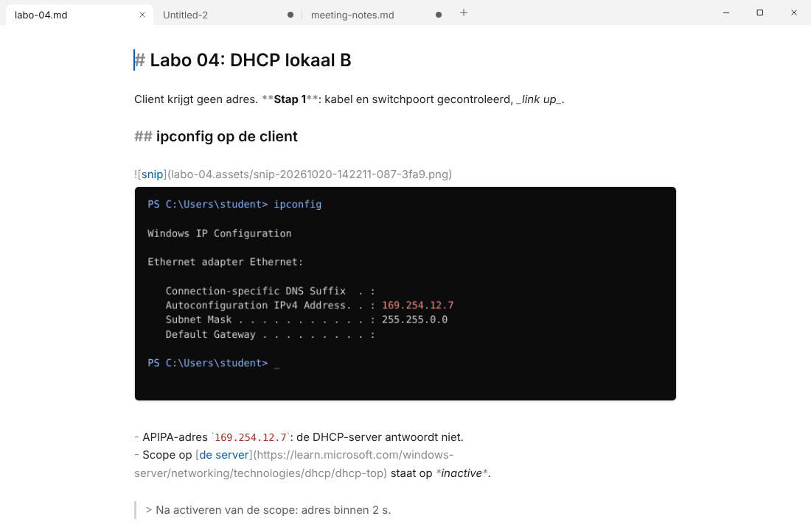

# SnipMD

**Paste, type, keep going.** A Windows note-taking app where a screenshot is as easy as a sentence.

1. `Win+Shift+S`: snip part of the screen with the Windows tool.
2. `Ctrl+V`: the image appears in your note, below the cursor, already saved to disk.
3. Keep typing. No dialog, no toast.

Notes are plain Markdown files with an image folder next to them (`labo-04.md` + `labo-04.assets/`), so they open without loss in VS Code, Obsidian and on GitHub. SnipMD never asks anything while you write and never loses anything: untitled notes, their screenshots and closed tabs survive a crash, Alt+F4 or a restart.



## What it does
- **Tabs** for notes; untitled tabs live in the session until you save them. Closing asks nothing and `Ctrl+Shift+T` brings the tab back, also after a restart.
- **Screenshots inline**: every local image link shows below its line, capped at 360 px; a click shows it at full size. Drop image files on a note to copy them in.
- **Saving**: notes save themselves a second after you stop typing, on blur and on close, with atomic writes that keep the file's line endings and BOM. The first `Ctrl+S` of a new note proposes a name from its first heading.
- **Changed outside SnipMD**: a clean tab reloads; a tab with edits shows *Open disk version · Reload · Keep mine*.
- **Read mode** (`Ctrl+E`) renders the note, sanitized: a Markdown file from someone else cannot run code or reach files.
- **Find and replace** (`Ctrl+F`, `Ctrl+H`) and light Markdown styling: larger headings, dimmed syntax, code and quotes set apart.
- Follows the Windows light or dark setting, with Mica behind the tab bar on Windows 11.

The full behaviour is in [`SPEC.md`](SPEC.md).

## Keyboard
| Keys | Action |
|---|---|
| `Ctrl+T` / `Ctrl+N` | New tab |
| `Ctrl+O` | Open a file |
| `Ctrl+S` / `Ctrl+Shift+S` | Save / Save As |
| `Ctrl+W` / `Ctrl+Shift+T` | Close tab / restore it |
| `Ctrl+Tab`, `Ctrl+1`…`9` | Next tab, go to tab N |
| `Ctrl+E` | Read mode |
| `Ctrl+F` / `Ctrl+H` | Find / replace |
| `Ctrl+Shift+V` | Paste as plain text |
| `F6` | Move focus between note, info bar and tabs |

## Install
Download `SnipMD_<version>_x64-setup.exe` from [Releases](../../releases). It installs per user, registers `.md` and `.markdown`, and fetches WebView2 if Windows lacks it. See [`RELEASE-WIN11.md`](RELEASE-WIN11.md) for building it yourself.

## Develop
Tauri v2 (Rust) with vanilla TypeScript, Vite, CodeMirror 6 and `marked`. Logic that needs no Tauri lives in the crate `src-tauri/core` (`snipmd-core`) and tests on any OS. Requires Node.js 22 and Rust stable; Windows 10 or 11 for the app itself.

```
npm ci
npm run tauri dev        # run the app
npm run lint             # typecheck
npm test                 # frontend unit tests
npm run build            # frontend bundle
cd src-tauri
cargo test -p snipmd-core
cargo check              # needs Windows (or GTK/WebKit on Linux)
```

- `tools/ui-tour/tour.cjs` screenshots every UI state in a browser with a mocked backend (`findings/ui/`).
- `tools/measure/measure.ps1` measures the performance budgets of SPEC §9 on Windows.
- [`ARCHITECTURE.md`](ARCHITECTURE.md) explains the code; [`CONTRIBUTING.md`](CONTRIBUTING.md) the rules for changes.

SnipMD is built with Claude (Anthropic) as the main author, working from `SPEC.md` and `PLAN.md`; the history of that work is in `PLAN.md`, `review/` and `findings/`.

## License
MIT
