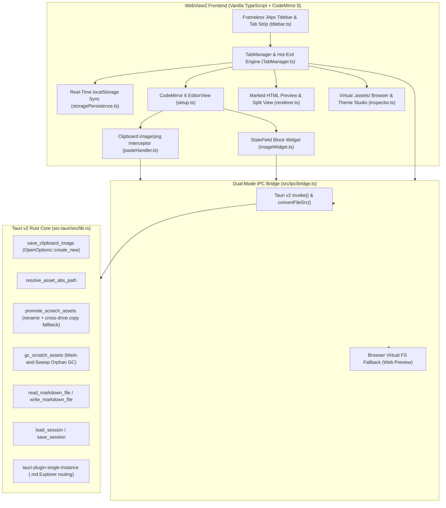

<div align="center">

# SnipMD

**Ultra-Lightweight Frameless Windows 11 Markdown & Screenshot Note-Taking Workspace**

[](https://v2.tauri.app/)
[](https://www.rust-lang.org/)
[](https://codemirror.net/)
[-0078D4?logo=windows11&logoColor=white)](./RELEASE-WIN11.md)
[](./LICENSE)

*Sublime Text's zero-ceremony multi-tab scratchpad ergonomics fused with instant `Win + Shift + S` → `Ctrl + V` inline screenshot capture and deterministic `.assets/` garbage collection.*

[**Architecture**](./ARCHITECTURE.md) · [**System Spec**](./SPEC.md) · [**Windows 11 Release Guide**](./RELEASE-WIN11.md) · [**Contributing**](./CONTRIBUTING.md) · [**Changelog**](./CHANGELOG.md)

</div>

---

## Why SnipMD?

Most Markdown editors fall into one of two extremes: barebones text editors that cannot paste screenshots without manual file-saving dialogs, or heavy Electron knowledge bases that take seconds to cold-start and lock your notes inside proprietary vaults.

**SnipMD** is engineered specifically for high-velocity engineering notes, debugging logs, and incident scratchpads on Windows 11:

- **Instant Cold-Start (<80ms) & Tiny Footprint (~3.5 MB)**: Built on **Tauri v2 (Rust)** and native Windows 11 WebView2 with LTO and symbol stripping—no bundled Chromium bloat.
- **Zero-Friction `Win + Shift + S` → `Ctrl + V` Snipping**: Take a screenshot with Windows Snipping Tool and press `Ctrl + V` directly in the editor. SnipMD intercepts the `image/png` clipboard payload, writes it atomically to disk as `snip-YYYYMMDD-HHMMSS-mmm-XXXX.png`, inserts ``, and renders the screenshot inline immediately below the Markdown line.
- **Always-On CodeMirror 6 Inline Image Widgets**: Screenshots render directly inside the raw Markdown editor via a multi-line safe `StateField<DecorationSet>` block widget (`max-height: 360px` by default; click any screenshot to toggle between compact `360px` and `100%` natural resolution).
- **Sublime-Style Hot-Exit & Unsaved Scratchpads**: Open new tabs (`Ctrl + T`), jot notes, and paste screenshots without ever being nagged by a "Save As" prompt. Unsaved buffers and cursor/scroll state persist automatically across restarts.
- **Deterministic `.assets/` Lifecycle & Mark-and-Sweep GC**:
  - **Saved Notes** store screenshots in a sidecar `<note-dir>/.assets/` folder.
  - **Unsaved Scratch Tabs** store screenshots in `%APPDATA%/snip-md/scratchpad/.assets/`.
  - Saving a scratch tab (`Ctrl + S`) promotes its referenced screenshots into the destination's sidecar `.assets/` folder (with cross-drive `C:\` → `D:\` fallback) and sweeps unreferenced orphans from the scratchpad pool.
- **8 Curated Full-Spectrum Themes**: Switch instantaneously between 8 hand-tuned themes spanning crisp daylight (*Alabaster Daylight*, *Warm Parchment*), low-glare mid-tones (*Botanical Mist*, *Nordic Polar Dusk*, *Tokyo Twilight*), and high-contrast dark surfaces (*Linear Spatial*, *Obsidian Stealth*, *Carbon OLED Terminal*).

---

## System Architecture



---

## Keyboard Shortcuts & Mouse Ergonomics

| Shortcut / Action | Behavior |
| :--- | :--- |
| **`Win + Shift + S` → `Ctrl + V`** | Capture region screenshot in Windows 11 and paste inline into the active note |
| **`Ctrl + T`** | Create a new unsaved `Untitled-N` scratchpad tab |
| **`Ctrl + O`** | Open an existing `.md` / `.markdown` file from disk |
| **`Ctrl + S`** | Save active tab (promotes scratchpad `.assets/` on first save) |
| **`Ctrl + W` / Middle-Click Tab** | Close tab and run mark-and-sweep GC on orphaned scratchpad assets |
| **`Ctrl + E`** | Cycle workspace view mode: **RAW + IMG** → **RENDERED** → **SPLIT** |
| **`Ctrl + \`*** | Toggle the right-hand **.assets/ Browser, Outline & Theme Studio** drawer |
| **`Ctrl + Tab`** | Cycle through open tabs |
| **Click Inline Screenshot** | Toggle screenshot height cap between compact **`360px`** and **`100%`** natural height |

---

## Curated Theme Suite (Light → Mid-Tone → Dark)

| # | Theme Name | Tier | Canvas | Primary Accent | Aesthetic Profile |
| :- | :--- | :--- | :--- | :--- | :--- |
| `01` | **Alabaster Daylight** | Light | `#fafaf9` | `#0f766e` | Architectural stone paper, deep ink prose, crimson headings |
| `02` | **Warm Parchment** | Light | `#f4efe6` | `#c2410c` | Archival drafting vellum, espresso ink, terracotta & olive tokens |
| `03` | **Botanical Mist** | In-Between | `#e8f0ec` | `#047857` | Soft sage drafting surface, deep pine ink, zero daytime glare |
| `04` | **Nordic Polar Dusk** | In-Between | `#2e3440` | `#88c0d0` | Arctic slate mid-tone, frost-blue accents, aurora syntax palette |
| `05` | **Tokyo Twilight** | In-Between | `#1f2335` | `#7aa2f7` | Deep indigo-violet storm twilight, electric periwinkle & coral |
| `06` | **Linear Spatial** | Dark | `#0f1117` | `#6366f1` | Floating pill tabs, obsidian-slate canvas, indigo elevation |
| `07` | **Obsidian Stealth** | Dark | `#18181b` | `#a855f7` | Classic SnipMD zinc, 1px razor hairlines, neon snip telemetry |
| `08` | **Carbon OLED Terminal** | Dark | `#050507` | `#f59e0b` | True pitch-black `#050507`, phosphor amber & matrix emerald |

---

## Quickstart & Development

### Prerequisites
- **Node.js** `>= 20.19.0` (Node 22 LTS recommended)
- **Rust Stable Toolchain** (`rustup` with `x86_64-pc-windows-msvc` and C++ Build Tools on Windows 11)

### 1. Run Browser Web Preview (Dual-Mode Virtual FS)
SnipMD includes a complete browser-compatible virtual filesystem and **+ Simulate Snip** generator so you can develop and test the UI in any browser without compiling Rust:

```bash
npm install --legacy-peer-deps
npm run dev
```

### 2. Run Native Desktop Window (Tauri v2 Dev Mode)
```bash
npm install --legacy-peer-deps
npm run tauri:dev
```

---

## Building the Windows 11 Release (`.exe` & `.msi`)

SnipMD packages into three native Windows 11 x64 targets:
1. **`SnipMD_0.1.0_x64-setup.exe`** — NSIS per-user installer with `.md`/`.markdown` File Explorer associations and WebView2 bootstrapper.
2. **`SnipMD_0.1.0_x64_en-US.msi`** — WiX MSI installer for enterprise deployment.
3. **`SnipMD_0.1.0_x64_Portable.exe`** — Standalone ~3.5 MB LTO single-file executable.

### Option A: 1-Click Local Build on Windows 11
Double-click **`build-win11-release.bat`** or run in PowerShell:
```powershell
.\build-win11-release.ps1
```
All three release artifacts are automatically compiled and staged into `./release-win11/`.

### Option B: Automated GitHub Actions Cloud Build
Push to `main` (or trigger the **Release Windows 11 (x64 NSIS, MSI & Portable)** workflow in the GitHub **Actions** tab). GitHub's `windows-latest` runner compiles and uploads the installers to Workflow Artifacts and GitHub Releases (`v0.1.0`).

---

## Repository Structure

```text
snip-md/
├── .github/
│   ├── ISSUE_TEMPLATE/          # Structured bug report & feature request forms
│   ├── workflows/
│   │   ├── ci.yml               # Continuous Integration (TS lint + Vite build + Cargo check)
│   │   └── release-win11.yml    # Automated Windows 11 x64 NSIS, MSI & Portable release pipeline
│   └── PULL_REQUEST_TEMPLATE.md
├── src/
│   ├── editor/
│   │   ├── imageWidget.ts       # CodeMirror 6 StateField<DecorationSet> block widget & sync URL cache
│   │   ├── pasteHandler.ts      # Clipboard image/png interceptor & atomic Markdown insertion
│   │   └── setup.ts             # CodeMirror 6 state factory, syntax highlighting & keymaps
│   ├── ipc/
│   │   └── bridge.ts            # Dual-mode Tauri v2 IPC + Browser Virtual FS parity layer
│   ├── preview/
│   │   └── renderer.ts          # Marked HTML renderer with .assets/ resolution & 360px toggle
│   ├── state/
│   │   ├── TabManager.ts        # Multi-tab lifecycle, scratchpad promotion, GC & shortcuts
│   │   └── storagePersistence.ts# Debounced 120ms + synchronous beforeunload localStorage engine
│   ├── styles/
│   │   ├── main.css             # Global CSS variable architecture & frameless 34px shell
│   │   └── themes.ts            # 8 full-spectrum theme palettes & runtime DOM variable injector
│   ├── ui/
│   │   ├── inspector.ts         # Virtual .assets/ Browser, Document Outline & Theme Studio
│   │   ├── modal.ts             # Lightbox zoom inspector, file dialogs & Win11 Release modal
│   │   └── titlebar.ts          # Frameless 34px tab strip, view mode switcher & window controls
│   ├── utils/
│   │   └── snipSimulator.ts     # High-DPI synthetic PNG generator for browser testing
│   └── main.ts                  # Application entry point
├── src-tauri/
│   ├── capabilities/default.json# Tauri v2 capability permissions (window, dialog, fs)
│   ├── icons/                   # 32-bit RGBA PNG & multi-resolution Windows 11 .ico assets
│   ├── src/
│   │   ├── lib.rs               # 9 Rust IPC commands, atomic create_new(true), mark-and-sweep GC
│   │   └── main.rs              # Windows subsystem entry point
│   ├── Cargo.toml               # Rust dependencies & LTO + strip release profile
│   └── tauri.conf.json          # Frameless window, assetProtocol & NSIS/MSI bundle config
├── ARCHITECTURE.md              # Detailed Mermaid sequence & state lifecycle diagrams
├── SPEC.md                      # Authoritative functional & UX specification
├── RELEASE-WIN11.md             # Windows 11 packaging & deployment documentation
├── CONTRIBUTING.md              # Contributor workflow & architectural invariants
├── SECURITY.md                  # Security & local-first privacy policy
├── CHANGELOG.md                 # Release history
└── LICENSE                      # MIT License
```

---

## License

Released under the [MIT License](./LICENSE).
