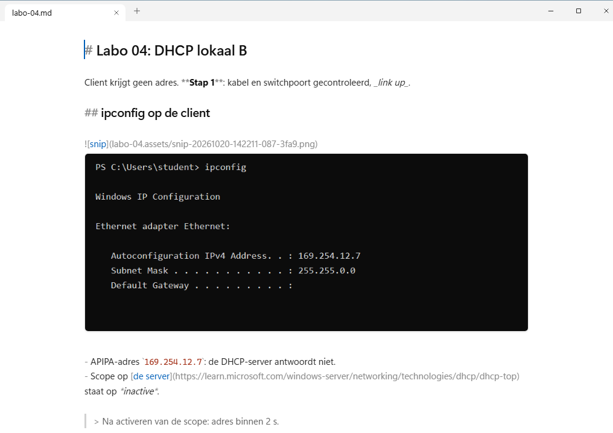
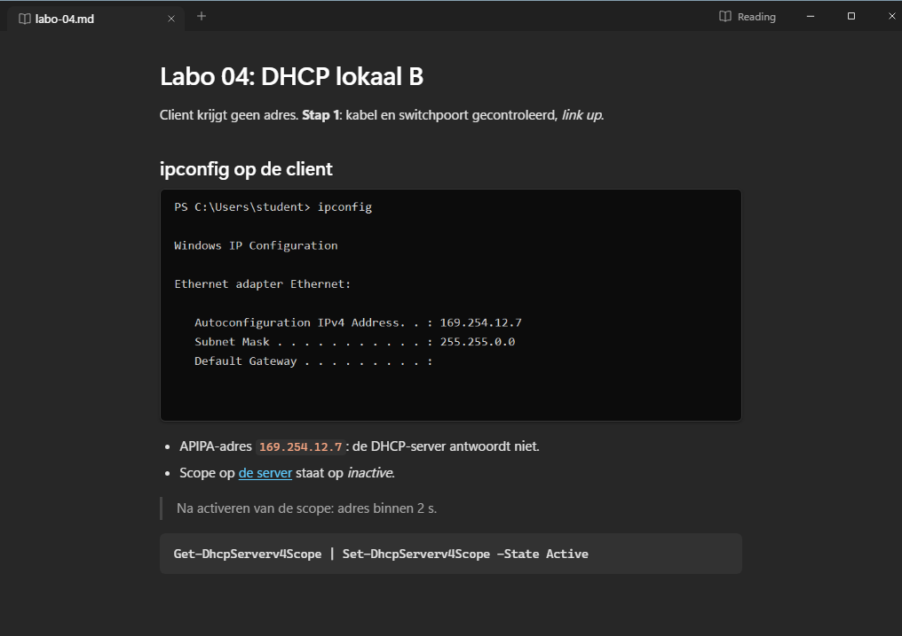

# SnipMD

[](https://github.com/ArneVDA-AP/snipmd/releases/latest)
[](https://github.com/ArneVDA-AP/snipmd/actions/workflows/ci.yml)
[](LICENSE)

**Paste, type, keep going.** A Markdown note app where a screenshot is as easy as a sentence.

1. `Win+Shift+S`: snip part of the screen.
2. `Ctrl+V`: the image appears in your note, already saved next to it.
3. Keep typing. No dialog, no "save image as".

| Writing | Reading (`Ctrl+E`) |
|---|---|
|  |  |

**[Download for Windows](https://github.com/ArneVDA-AP/snipmd/releases/latest)** · Windows 10 and 11 (x64), a 1.5 MB installer, no admin rights.
macOS 13+ is in preview: see [Installing on macOS](docs/install-macos.md).

## Your notes stay yours
Notes are plain Markdown files with an image folder next to them (`labo-04.md` + `labo-04.assets/`). They open as they are in VS Code, Obsidian and on GitHub, and keep working if you stop using SnipMD. Save a note into an Obsidian vault and Obsidian shows its screenshots; a note open in both apps stays in step.

## It never loses anything
- **Untitled notes survive a crash, Alt+F4 or a restart**, screenshots included.
- **Notes save themselves** a second after you stop typing. Every write replaces the file in one step, so a crash never leaves half a note, and the file keeps its line endings and encoding.
- **Closing a tab asks nothing.** `Ctrl+Shift+T` brings it back, also after a restart.
- **Changes made elsewhere are noticed.** An unedited tab reloads; a tab with edits asks before anything is overwritten.

## What else it does
- **Tabs**, which you can drag into order. The first save proposes a name from the note's first heading.
- **Inline images.** Every local image link shows below its line; drop image files on a note to copy them in.
- **Read mode** (`Ctrl+E`) with clickable task boxes and a Copy button on code blocks.
- **Code highlighting** for JavaScript, TypeScript, JSON, CSS, HTML, Python, Rust, SQL, shell and YAML.
- **Command menu** (`Ctrl+Shift+P`) for every command and the few options there are.
- **Find and replace** with a match count, and lists that keep their numbering as you edit.
- **Looks like your system**: light or dark, with Mica behind the tabs on Windows 11.

## Safe with notes from others
A Markdown file someone sends you can't run code or reach your files through SnipMD: read mode is sanitized, images load only from the note's own folder, and links open in your browser. SnipMD makes no network connections and collects nothing. See the [security policy](.github/SECURITY.md).

## Keyboard
On macOS, `Cmd` replaces `Ctrl`.

| Keys | Action |
|---|---|
| `Ctrl+T` / `Ctrl+O` | New tab / open a file |
| `Ctrl+S` / `Ctrl+Shift+S` | Save / Save As |
| `Ctrl+W` / `Ctrl+Shift+T` | Close tab / bring it back |
| `Ctrl+Tab`, `Ctrl+1`…`9` | Next tab, go to tab N |
| `Ctrl+Shift+PageUp` / `PageDown` | Move the tab left / right |
| `Ctrl+Shift+P` | Command menu |
| `Ctrl+E` | Read mode |
| `Ctrl+F` / `Ctrl+H` | Find / replace |
| `Ctrl+Shift+V` | Paste as plain text |

## Install
Download `SnipMD_<version>_x64-setup.exe` from [Releases](https://github.com/ArneVDA-AP/snipmd/releases/latest). It installs per user, registers `.md` and `.markdown`, and fetches WebView2 if Windows lacks it; pick SnipMD once under *Open with* to open notes with a double-click. The installer is not code-signed yet, so SmartScreen may warn on the first run: choose *More info*, then *Run anyway*. Signing is on its way: see the [code signing policy](docs/code-signing.md).

An MSI for managed installs and a portable exe are on the same page.

## What's new
See the [release notes](https://github.com/ArneVDA-AP/snipmd/releases) or the [changelog](CHANGELOG.md).

## Building and contributing
Node.js 22 and Rust stable:

```
npm ci
npx tauri build
```

See [CONTRIBUTING](.github/CONTRIBUTING.md). SnipMD is written with Claude (Anthropic) as the main author.

## License
[MIT](LICENSE)
